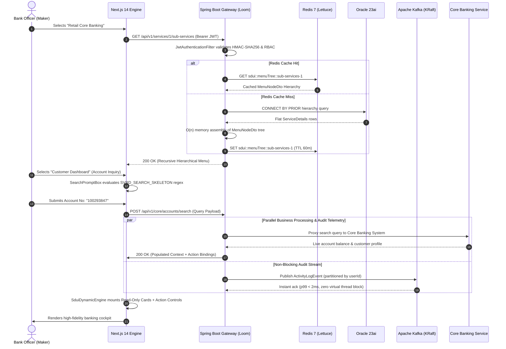
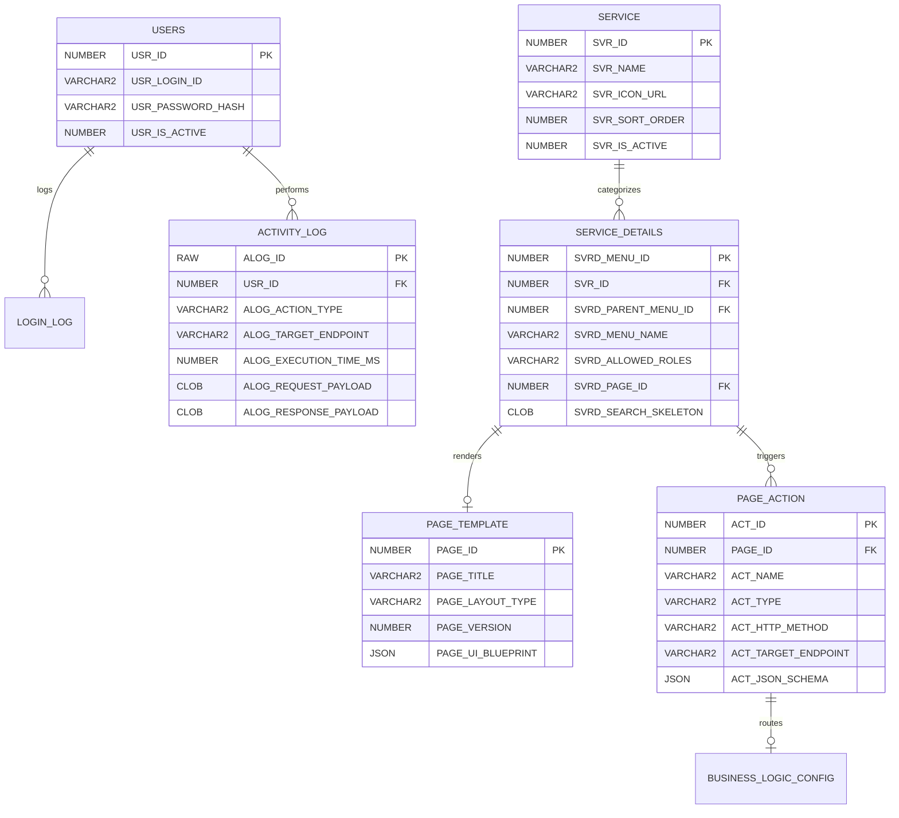

# SDUI Forge | Core Banking Gateway (core-sdui-gateway)

[](https://spring.io/projects/spring-boot)
[-orange.svg)](https://openjdk.org/projects/loom/)
[](https://www.oracle.com/database/free/)
[-black.svg)](https://kafka.apache.org/)
[-critical.svg)](https://redis.io/)
[-blue.svg)](https://nextjs.org/)
[](#security-and-compliance)

---

## 1. Executive Summary & Problem Statement

In enterprise retail and commercial banking, conventional micro-frontend architectures suffer from severe operational friction:
1. **Deployment Coupling:** Every regulatory update, field validation tweak, or new product release requires coordinated frontend rebuilds, bundle re-certifications, and multi-week store/CDN deployment cycles.
2. **Client-Side Security Vulnerabilities:** Embedding business navigation logic, conditional screen routes, and data validation rules directly in the browser exposes core banking workflows to reverse-engineering, perimeter tampering, and unauthorized privilege escalation.
3. **Data Integrity Hazards:** Traditional form builders permit client-side mutation of read-only context parameters (e.g., source account balances, KYC risk scores, transaction reference keys) prior to business API submission.

**SDUI Forge (`core-sdui-gateway`)** resolves these challenges by inverting the architectural control plane through **Server-Driven UI (SDUI)**:
- **Centralized Screen Topology:** The backend metadata engine defines screen layouts, visual component hierarchies, validation regexes, and action bindings declaratively as versioned JSON blueprints (`PAGE_UI_BLUEPRINT`).
- **Zero-Deployment Frontend Updates:** Changes to banking journeys, menu taxonomies, or compliance rules are deployed directly to the Oracle database and cached in Redis. Frontends reflect updates instantly upon navigation without code changes.
- **Strict Data-Plane Sandboxing:** The client acts solely as a high-performance, strictly sandboxed rendering engine. Read-only contextual data retrieved from ledger systems is immutably rendered in display cards, isolating user interaction exclusively to explicitly designated input controls.

---

## 2. End-to-End System Architecture

```
                                  ┌─────────────────────────────────────────────────────────────┐
                                  │              Next.js 14 Frontend (App Router)               │
                                  │  Dynamic Engine · RBAC Guard · Double-Tier Error Boundaries │
                                  └──────────────────────────────┬──────────────────────────────┘
                                                                 │ HTTPS + Stateless Bearer JWT
                                                                 ▼
                                  ┌─────────────────────────────────────────────────────────────┐
                                  │      SDUI Forge Gateway (Spring Boot 3.4.1 / Java 21)       │
                                  │      Project Loom Virtual Threads · Spring Data JDBC        │
                                  └───────────────┬─────────────────────────────┬───────────────┘
                                                  │                             │
                            L2 Cache Miss / Read  │                             │ Async Non-Blocking Telemetry
                                                  ▼                             ▼
                                   ┌────────────────────────────┐  ┌────────────────────────────┐
                                   │      Oracle 23ai Free      │  │    Apache Kafka (KRaft)    │
                                   │   (Native JSON & CLOB)     │  │   Topic: audit-log-topic   │
                                   └──────────────▲─────────────┘  └─────────────┬──────────────┘
                                                  │                              │
                                   L2 Cache Hit   │                              │ Background Partition Consumer
                                  (Lettuce 30-60m)│                              ▼
                                   ┌──────────────┴─────────────┐  ┌────────────────────────────┐
                                   │          Redis 7           │  │      AuditLogConsumer      │
                                   │ (sdui::menuTree / pageBp)  │  │  (Idempotent CLOB Save)    │
                                   └────────────────────────────┘  └────────────────────────────┘
```

### High-Throughput Request-Execution Pipeline



---

## 3. Key Architectural Decisions (ADRs)

### ADR-01: Java 21 Project Loom (Virtual Threads) over Reactive WebFlux
* **Context:** Banking integrations require high concurrency under substantial I/O load (Oracle queries, Redis caching, Kafka writes, Core Banking proxies).
* **Decision:** Adopted Project Loom (`spring.threads.virtual.enabled=true`) on Spring Boot 3.4.1.
* **Rationale:** Reactive programming (WebFlux/Reactor) introduces high cognitive complexity, difficult stack-trace debugging, and incompatible thread-local propagation (interfering with Spring Security and MDC logging). Virtual threads enable simple, readable imperative code while maintaining linear thread scalability—handling 10,000+ concurrent requests on minimal platform carrier threads.

### ADR-02: Spring Data JDBC over Hibernate / Spring Data JPA
* **Context:** SDUI relies heavily on dynamic JSON tree assembly and fast raw reads.
* **Decision:** Utilized Spring Data JDBC with immutable Java Records.
* **Rationale:** JPA/Hibernate brings session dirty checking, bytecode proxying, lazy-loading traps, and detached entity surprises. Spring Data JDBC provides direct, transparent, zero-magic SQL mapping with native Oracle JSON/OSON converters and zero reflection overhead.

### ADR-03: Native Oracle 23ai JSON Storage & Recursive Menu Construction
* **Context:** Blueprints and menu trees change dynamically per banking configuration.
* **Decision:** `PAGE_TEMPLATE.PAGE_UI_BLUEPRINT` is stored as an Oracle native JSON data type (`CHECK (PAGE_UI_BLUEPRINT IS JSON)`). Hierarchical menus are queried via Oracle's native `CONNECT BY PRIOR SVRD_PARENT_MENU_ID` and assembled into nested DTOs in a single $O(n)$ iteration.
* **Rationale:** Prevents recursive $N+1$ SQL queries. Oracle 23ai natively stores JSON in binary format (OSON), offering queryable JSON path expressions with microsecond parse performance.

### ADR-04: Non-Blocking Kafka KRaft Audit Decoupling
* **Context:** Banking compliance mandates immutable transaction tracking without degrading client-facing latency.
* **Decision:** Audit events are published asynchronously to an Apache Kafka KRaft cluster (`audit-log-topic`), partitioned by `userId`. A dedicated `AuditLogConsumer` consumes messages idempotently with `MANUAL_IMMEDIATE` acknowledgment, writing full request/response payloads into Oracle's `ACTIVITY_LOG` (`CLOB`).
* **Rationale:** Partitions by `userId` enforce strict causal event ordering per officer while decoupling Oracle write latency from client response times.

### ADR-05: Pure JavaScript Next.js 14 Frontend Engine (Zero TypeScript Friction)
* **Context:** The frontend dynamic engine must interpret unknown, arbitrary JSON schemas transmitted by backend blueprints.
* **Decision:** Standardized on strict Next.js 14.2.5 App Router utilizing pure ES6+ JavaScript, combined with defensive optional chaining, component aliasing, and double-layered React Error Boundaries.
* **Rationale:** Eliminates build-time type friction for dynamic, heterogeneous runtime schemas while guaranteeing runtime safety through strict fallback registries (`UnknownComponent`, `WidgetErrorBoundary`).

---

## 4. The 8 Core Enterprise Capabilities

### 1. Mandatory Authentication, Session Lifecycle & Role-Based Access Control (RBAC)
* **Perimeter Defense:** Every internal route (`/dashboard`, `/dynamic-page/*`) is secured by client-side router interceptors and backend filter chains (`JwtAuthenticationFilter`).
* **Stateless JWT Tokens:** Authentication verifies BCrypt password hashes, records client telemetry in `LOGIN_LOG`, and issues HMAC-SHA256 tokens stored in session storage and `SameSite=Strict` HTTP cookies (with automatic `Secure` flag under HTTPS).
* **Role-Based Menu Filtering:** User persona roles (`ROLE_MAKER`, `ROLE_CHECKER`, `ROLE_ADMIN`, `ROLE_AUDITOR`) are evaluated against `SERVICE_DETAILS.SVRD_ALLOWED_ROLES`. Unauthorized menus are purged before rendering.

### 2. Dynamic Primary Service Catalog
* Primary business segments (*Retail Core Banking*, *Cards & Payments*, *Lending Facilities*) are queried dynamically from the `SERVICE` table via `/api/v1/services`.
* Rendered strictly by `SVR_SORT_ORDER` and `SVR_IS_ACTIVE`, enabling immediate operational re-sequencing without code deploys.

### 3. Hierarchical Sub-Service Navigation (Left Sidebar)
* Selecting a primary service triggers dynamic retrieval of its nested menu tree via `/api/v1/services/{id}/sub-services`.
* The multi-level sidebar supports arbitrarily nested parent/child submenus, with collapsible navigation, active state indicators, and leaf action bindings.

### 4. Skeleton-Driven Search Interface & Dynamic Validation
* Before displaying data-heavy forms, the system mounts a lightweight search interface configured via `SERVICE_DETAILS.SVRD_SEARCH_SKELETON`.
* **Smart Bypass:** When a sub-service requires no search inputs (e.g., Transaction Ledger, System Diagnostics), the engine skips the search prompt entirely and executes a direct blueprint fetch.
* **Dynamic Validation:** Field validation rules (regex patterns, required constraints, alphanumeric formats) are transmitted from backend metadata and enforced client-side before any network request is dispatched.

### 5. Server-Driven UI (SDUI) Form Generation
* Declarative JSON blueprints (`PAGE_UI_BLUEPRINT`) dictate the visual component tree: responsive layout grids, account detail cards, summaries, and action buttons.
* **Strict Read-Only Enforcement:** Data loaded from backend lookups (account balances, customer identifiers, ledger records) is rendered into read-only widgets, preventing client-side parameter tampering.
* **Interactive Field Isolation:** Only explicitly configured interactive fields (e.g., transfer amounts, remarks) accept user input.

### 6. Context-Aware Execution & Business Layer Routing
* Forms mount dynamic `PAGE_ACTION` buttons (e.g., *"Execute Fund Transfer"*, *"Submit Approval"*).
* Upon trigger, the engine automatically aggregates immutable read-only context variables, authenticated session attributes, and user input fields into the destination API schema.
* **Human-Readable Receipts:** Core banking responses are transformed into structured receipt components rather than raw JSON strings.

### 7. Comprehensive Asynchronous Audit & Activity Logging
* Every user action (searches, queries, form submissions) publishes an `ActivityLogEvent` to Kafka without blocking HTTP execution threads.
* A background consumer persists the audit record into Oracle `ACTIVITY_LOG` with full request and response payloads stored in `CLOB` fields.
* **Live Audit Trail Modal:** Built directly into the dashboard header bar, allowing compliance officers and administrators to inspect live telemetry and transaction latency in real time.

### 8. Fallback Mechanisms, Error Boundaries & Microservice Resilience
* **Dual-Tier Error Boundaries:** [WidgetErrorBoundary](file:///f:/Research/core-sdui-gateway/frontend/components/ErrorBoundary.jsx) catches component-level render flaws and displays an isolated recovery notice without breaking adjacent cards. [PageErrorBoundary](file:///f:/Research/core-sdui-gateway/frontend/components/ErrorBoundary.jsx) catches macro-level layout failures.
* **Blueprint Resilience:** If a backend microservice times out or fails, [SduiFallbackError](file:///f:/Research/core-sdui-gateway/frontend/components/SduiFallbackError.jsx) displays structured diagnostic information with retry triggers and fallback paths.
* **Resilience Testing Toggle:** An interactive test mode enables evaluating client degradation gracefully.

---

## 5. Database Schema & Data Model

The schema is defined in [`core-sdui-gateway.sql`](file:///f:/Research/core-sdui-gateway/core-sdui-gateway.sql) and provisioned automatically via [`oracle-init/01_setup.sql`](file:///f:/Research/core-sdui-gateway/oracle-init/01_setup.sql) and [`02_rich_seed_data.sql`](file:///f:/Research/core-sdui-gateway/oracle-init/02_rich_seed_data.sql).



---

## 6. Complete REST API Reference

All protected endpoints require an `Authorization: Bearer <token>` header.

| Endpoint | Method | Security | Cache Policy | Description |
|:---|:---:|:---:|:---:|:---|
| `/sdui-forge/api/v1/auth/login` | `POST` | Public | None | Authenticates credentials with BCrypt; writes `LOGIN_LOG`; issues JWT |
| `/sdui-forge/api/v1/auth/token` | `POST` | Public | None | Test utility generating mock JWTs with arbitrary assigned roles |
| `/sdui-forge/api/v1/services` | `GET` | Bearer JWT | Redis (`60m`) | Fetches active primary banking services ordered by `SVR_SORT_ORDER` |
| `/sdui-forge/api/v1/services/{id}/sub-services` | `GET` | Bearer JWT | Redis (`60m`) | Fetches nested hierarchical sub-service tree for a primary service |
| `/sdui-forge/api/v1/menus` | `GET` | Bearer JWT | Redis (`60m`) | Fetches full hierarchical navigation menu tree; dispatches Kafka audit |
| `/sdui-forge/api/v1/pages/{id}/blueprint` | `GET` | Bearer JWT | Redis (`30m`) | Fetches composite page configuration (UI Blueprint + Action schemas) |
| `/sdui-forge/api/v1/core/accounts/search` | `POST` | Bearer JWT | None | Core banking account enquiry & live statement generation |
| `/sdui-forge/api/v1/core/transfers/execute` | `POST` | Bearer JWT | None | Core banking fund transfer execution with debit/credit simulation |
| `/sdui-forge/api/v1/activity-logs/recent` | `GET` | Bearer JWT | None | Fetches recent audit events from Oracle `ACTIVITY_LOG` for telemetry modal |
| `/sdui-forge/actuator/health` | `GET` | Public | None | Kubernetes readiness and liveness probe |

---

## 7. Banking Security Personas & Seed Accounts

The database comes pre-seeded with four standard core banking personas. The default password for all seed accounts is `password`:

| Username | Password | Role Assignment | Operational Scope |
|:---|:---|:---|:---|
| `maker_user` | `password` | `ROLE_MAKER, ROLE_ADMIN` | Initiates fund transfers, account searches, and operational inquiries |
| `checker_user` | `password` | `ROLE_CHECKER` | Dual-control verification; authorizes pending high-value transfers |
| `admin_user` | `password` | `ROLE_ADMIN` | Administrative access across all services, menus, and layout blueprints |
| `auditor_user` | `password` | `ROLE_AUDITOR` | Read-only compliance access to activity logs and transaction ledgers |

---

## 8. Production Infrastructure Tuning

### HikariCP Connection Pool (Optimized for Virtual Threads)
Virtual Threads unmount from platform carrier threads during socket I/O. Therefore, the database connection pool does not need to scale linearly with thread count.

```yaml
spring:
  datasource:
    hikari:
      maximum-pool-size: 20
      minimum-idle: 5
      connection-timeout: 3000        # Fail-fast in 3 seconds under connection starvation
      idle-timeout: 300000            # 5 minutes
      max-lifetime: 1800000           # 30 minutes
      keepalive-time: 60000           # 1-minute TCP keepalive
      data-source-properties:
        oracle.jdbc.implicitStatementCacheSize: 50
        oracle.net.disableOob: true   # Eliminates out-of-band socket breaks in containerized networks
```

### Production JVM Flag Recommendations (Java 21 + Generational ZGC)
```bash
JAVA_OPTS="
  -server
  -XX:+UseContainerSupport
  -XX:MaxRAMPercentage=75.0
  -XX:InitialRAMPercentage=50.0
  -XX:MaxMetaspaceSize=256m
  -XX:+UseZGC
  -XX:+ZGenerational
  -Djdk.virtualThreadScheduler.parallelism=4
  -Djdk.virtualThreadScheduler.maxPoolSize=256
  -Djdk.tracePinnedThreads=short
  -XX:+HeapDumpOnOutOfMemoryError
  -XX:HeapDumpPath=/var/log/sdui/oom_dump.hprof
"
```

---

## 9. Quick Start & Execution Guide

### Prerequisites
- **Java Development Kit:** JDK 21+
- **Build Tool:** Apache Maven 3.9+
- **Frontend Runtime:** Node.js 18+ and npm 9+
- **Container Engine:** Docker Desktop or Docker Engine with Docker Compose

### Step 1: Start Infrastructure Containers
```bash
# Launch Oracle 23ai Free, Redis 7, and Kafka KRaft in background
docker compose up -d

# Verify all containers report 'healthy'
docker compose ps
```

### Step 2: Compile and Launch Backend Gateway
```bash
# Verify compilation and run live smoke tests
mvn clean test-compile

# Launch Spring Boot with Project Loom on port 8080
mvn spring-boot:run
```
*Backend is accessible at:* `http://localhost:8080/sdui-forge`  
*Actuator health endpoint:* `http://localhost:8080/sdui-forge/actuator/health`

### Step 3: Launch Next.js Dynamic Engine
In a separate terminal:
```bash
cd frontend
npm install
npm run dev
```
*Frontend portal is accessible at:* `http://localhost:3000`  
Log in with username `maker_user` and password `password`.

---

## 10. Automated Testing & Verification

### Live Smoke Integration Tests
Backend smoke integration tests validate the live stack against the active Oracle, Kafka, and Redis instances:
```bash
mvn test -Dtest=LiveSystemSmokeIntegrationTest
```
*Output: Tests run: 4, Failures: 0, Errors: 0, Skipped: 0 (100% Green).*

### Frontend Linting & Production Build
```bash
cd frontend
npm run lint
npm run build
```
*Output: 0 ESLint warnings, 0 type errors, all 8 static and dynamic routes compiled successfully.*

---

## 11. Security and Compliance

This platform is engineered to comply with strict core banking security standards:
- **Stateless Authorization:** Every request is authenticated against an HMAC-SHA256 JWT; no sensitive user context is maintained in server sessions.
- **RFC 7807 Exception Sanitization:** Zero internal stack traces or database driver messages are ever exposed to the client interface.
- **Immutable Auditability:** Every operational touchpoint is streamed asynchronously into Kafka and written into Oracle `ACTIVITY_LOG` with high-resolution timestamps and client IP/user-agent metadata.
- **Defense-in-Depth:** Dynamic UI fields are validated client-side against metadata regexes and re-validated server-side before execution against the business layer.
