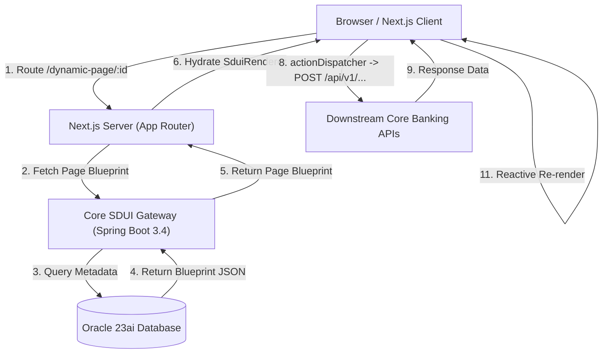
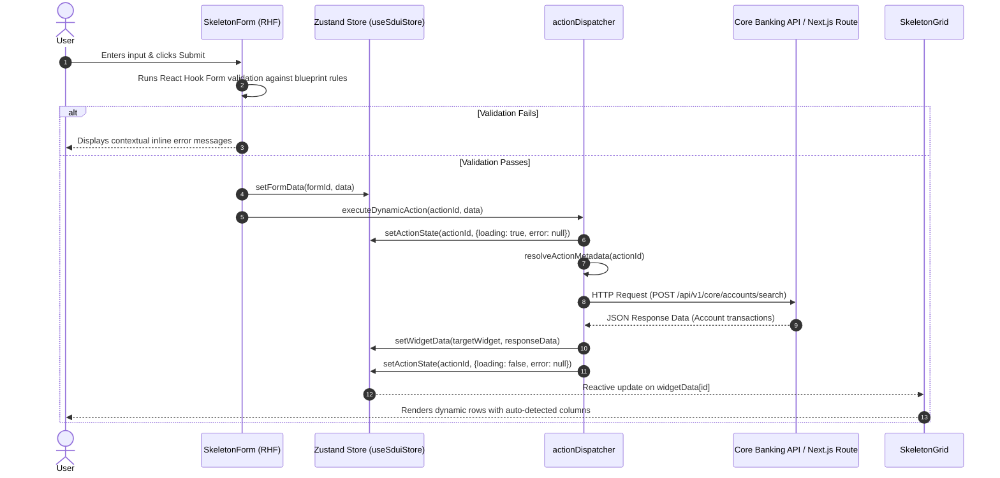

# Core SDUI Gateway (`core-sdui-gateway`)

[](https://openjdk.org/projects/loom/)
[](https://spring.io/projects/spring-boot)
[](https://spring.io/projects/spring-data-jdbc)
[](https://www.oracle.com/database/23ai/)
[](https://nextjs.org/)
[](https://react.dev/)
[](https://github.com/pmndrs/zustand)
[](https://react-hook-form.com/)

> **An enterprise Server-Driven UI (SDUI) Metadata Engine & Gateway designed for mission-critical core banking platforms.**  
> Decouples core banking business workflows and UI layouts from client deployment cycles. The backend serves declarative JSON blueprints and action definitions; the frontend dynamically validates, resolves, and mounts accessible, reactive UI widgets on-the-fly.

---

## Table of Contents

- [Overview & Architecture](#overview--architecture)
- [System Architecture Diagram](#system-architecture-diagram)
- [Project Phases & Status](#project-phases--status)
- [Phase 3 Interactive Flow](#phase-3-interactive-flow)
- [Repository Layout](#repository-layout)
- [Backend Specification (Phase 1)](#backend-specification-phase-1)
- [Frontend Specification (Phase 2 & 3)](#frontend-specification-phase-2--3)
- [Quick Start Guide](#quick-start-guide)
  - [Prerequisites](#prerequisites)
  - [Running Backend](#running-backend)
  - [Running Frontend](#running-frontend)
- [Extending Widgets & Actions](#extending-widgets--actions)
- [Defensive Programming & Safety](#defensive-programming--safety)
- [Phase Deliverables Reference](#phase-deliverables-reference)

---

## Overview & Architecture

In high-compliance core banking environments, pushing mobile or web releases through change boards and app stores creates friction and latency for product teams. **Core SDUI Gateway** solves this by shifting layout composition, validation rules, and business action choreography to a centralized backend metadata engine.

### Key Capabilities
- **Zero-Deploy UI Updates**: Introduce forms, change layouts, reorder fields, or alter validation rules dynamically via JSON blueprints.
- **High Concurrency & Low Latency**: Powered by Java 21 Project Loom (Virtual Threads) and lightweight Spring Data JDBC (zero Hibernate N+1 or session-cache risks).
- **Oracle 23ai JSON Support**: Direct persistence of flexible UI widget metadata in native JSON columns.
- **Dynamic Interactivity**: Frontend driven by a central **Zustand** store, **React Hook Form** with schema-less dynamic validation rules, and an asynchronous **Action Dispatcher**.
- **Defensive Resilience**: Resilient JavaScript engine with automated fallback rendering (`UnknownComponent`) and error boundaries to prevent runtime crashes.

---

## System Architecture Diagram



---

## Project Phases & Status

| Phase | Description | Key Tech Stack | Status |
|:---:|---|---|:---:|
| **Phase 1** | **Database Schema & Core Backend Gateway**<br>Direct SQL execution, schema DDL, Oracle 23ai JSON columns, Loom Virtual Threads, REST blueprint endpoints. | Java 21, Spring Boot 3.4, Spring Data JDBC, Oracle 23ai, HikariCP | ✅ Complete |
| **Phase 2** | **Frontend Skeleton & Recursive SDUI Engine**<br>Next.js 14 App Router, recursive `SduiRenderer`, dynamic `componentRegistry`, responsive layout engine. | Next.js 14, React 18, Tailwind CSS, JavaScript ES6+ | ✅ Complete |
| **Phase 3** | **Dynamic Actions, Form Validation & Data Binding**<br>Zustand triple-domain store, React Hook Form dynamic blueprint rules, central action dispatcher, data-bound `SkeletonGrid`. | Zustand, React Hook Form, Custom Dispatcher | ✅ Complete |
| **Phase 4** | **RBAC, Auth Context & Menu Ingestion**<br>Role-gated widget rendering, token propagation, global navigation tree. | NextAuth / JWT, Spring Security 6 | ⏳ Planned |
| **Phase 5** | **Expanded Enterprise Widget Library**<br>Dynamic Charts, Multi-tab layouts, Stepper workflows, Modals, Node-level Error Boundaries. | Recharts, Headless UI | ⏳ Planned |

---

## Phase 3 Interactive Flow

The end-to-end interactivity pipeline coordinates the form submission, rule verification, async action dispatch, store mutation, and reactive grid binding:



---

## Repository Layout

```text
core-sdui-gateway/
├── pom.xml                                   # Spring Boot 3.4 Maven configuration (Java 21)
├── src/                                      # Backend implementation (Phase 1)
│   ├── main/
│   │   ├── java/com/sdui/forge/
│   │   │   ├── SduiForgeApplication.java     # Spring Boot application entry point
│   │   │   ├── config/                       # Data JDBC, HikariCP, Virtual Threads config
│   │   │   ├── controller/                   # REST endpoints (/pages/{id}/blueprint, /actions)
│   │   │   ├── model/                        # Domain entities & blueprint records
│   │   │   ├── repository/                   # Spring Data JDBC repositories
│   │   │   └── service/                      # Metadata & blueprint aggregation service
│   │   └── resources/
│   │       ├── application.yml               # Virtual threads, datasource, HikariCP settings
│   │       └── schema-oracle.sql             # Oracle 23ai DDL with JSON column definitions
│   └── test/                                 # Unit & integration tests
├── phase1_deliverables.md                    # Detailed Phase 1 architecture & DDL documentation
├── phase2_deliverables.md                    # Detailed Phase 2 frontend engine documentation
├── phase3_deliverables.md                    # Detailed Phase 3 state & interactivity documentation
├── README.md                                 # Master repository documentation
└── frontend/                                 # Next.js 14 App Router application (Phase 2 & 3)
    ├── app/
    │   ├── layout.jsx                        # Root HTML shell & global font styles
    │   ├── globals.css                       # Tailwind CSS directives & theme rules
    │   ├── dynamic-page/[pageId]/page.jsx    # Dynamic Server Component page route
    │   └── api/v1/core/accounts/search/      # Mock core banking API route handler
    │       └── route.js
    ├── components/
    │   ├── SduiRenderer.jsx                  # Recursive JSON tree renderer & layout mapper
    │   └── skeletons/
    │       ├── SkeletonCard.jsx              # Content card widget
    │       ├── SkeletonForm.jsx              # React Hook Form widget with dynamic rule parsing
    │       ├── SkeletonGrid.jsx              # Data-bound reactive table widget
    │       └── UnknownComponent.jsx          # Defensive fallback component
    ├── store/
    │   └── useSduiStore.js                   # Zustand store (formData, widgetData, actionStates)
    ├── utils/
    │   ├── actionDispatcher.js               # Dynamic action execution & store update engine
    │   └── componentRegistry.js              # Type-to-Component registry
    ├── lib/
    │   └── mockBlueprint.js                  # In-memory blueprint mock & payload adapter
    ├── jsconfig.json                         # Absolute path aliases (@/*)
    ├── next.config.mjs                       # Next.js configuration
    ├── tailwind.config.js                    # Tailwind styling tokens
    └── package.json                          # Frontend dependencies (Zustand, React Hook Form)
```

---

## Backend Specification (Phase 1)

### Technical Stack
- **Runtime:** Java 21 LTS with **Project Loom** (`spring.threads.virtual.enabled=true`).
- **Framework:** Spring Boot 3.4.x.
- **Persistence:** Spring Data JDBC (direct SQL execution; strict avoidance of Hibernate session overhead and N+1 query patterns).
- **Database:** Oracle 23ai featuring native `JSON` column support.
- **Connection Pool:** HikariCP tuned for virtual-thread non-blocking I/O.

### Endpoints
- `GET /sdui-forge/api/v1/pages/{pageId}/blueprint` — Fetches assembled layout, widgets, and dynamic properties for a given page.
- `GET /sdui-forge/api/v1/actions/{actionId}` — Fetches action definition (HTTP method, target endpoint, target widget ID).

---

## Frontend Specification (Phase 2 & 3)

### Technical Stack
- **Framework:** Next.js 14 (App Router).
- **View Layer:** React 18 (Server & Client Components).
- **Language:** JavaScript (ES6+ / JSX) — strictly avoiding TypeScript overhead while enforcing rigorous runtime assertions.
- **State Management:** **Zustand** store (`useSduiStore.js`) managing:
  - `formData`: Isolated per-form key-value state.
  - `widgetData`: Dynamic response datasets mapped to target widget IDs.
  - `actionStates`: Operation status (`loading`, `error`, `success`) keyed by `actionId`.
- **Form Engine:** **React Hook Form** dynamically mapping blueprint validation schemas:
  - `required`, `minLength`, `maxLength`, `pattern`, `min`, `max`, and custom `patternMessage`.
- **Styling:** Tailwind CSS 3.4 with responsive stack and grid wrappers.

---

## Quick Start Guide

### Prerequisites
- **JDK 21** (e.g., Eclipse Temurin 21 or Oracle GraalVM 21).
- **Maven 3.9+**.
- **Node.js 18.18+** or **Node.js 20+** and **npm 9+**.

### Running Backend

```bash
# From repository root
mvn clean spring-boot:run
```

The Spring Boot backend will initialize on port `8080` with Virtual Threads enabled.

### Running Frontend

```bash
# Navigate to frontend directory
cd frontend

# Install dependencies (Zustand, React Hook Form, Next.js, React, Tailwind)
npm install

# Start local Next.js development server
npm run dev
```

Visit the interactive pages in your browser:
- **Interactive Banking Form & Data-Bound Grid:**  
  [http://localhost:3000/dynamic-page/101](http://localhost:3000/dynamic-page/101)  
  *Try entering an invalid account number (e.g. fewer than 10 digits or letters) to see the dynamic blueprint validation in action, or enter `1234567890` and submit to see the Action Dispatcher query the mock API and reactively populate the `SkeletonGrid`.*
- **Fallback Resilience Demo:**  
  [http://localhost:3000/dynamic-page/999](http://localhost:3000/dynamic-page/999)  
  *Demonstrates how unregistered widget types safely render `UnknownComponent` fallback cards without interrupting overall page execution.*

### Production Build

```bash
cd frontend
npm run build
npm run start
```

---

## Extending Widgets & Actions

### 1. Adding a New UI Widget
1. Create the component under `frontend/components/skeletons/` (e.g., `SkeletonChart.jsx`).
2. Register the component in `frontend/utils/componentRegistry.js`:
   ```javascript
   import SkeletonChart from "@/components/skeletons/SkeletonChart";

   const REGISTRY = {
     Skeleton_Card: SkeletonCard,
     Skeleton_Form: SkeletonForm,
     Skeleton_Grid: SkeletonGrid,
     Skeleton_Chart: SkeletonChart, // <-- New widget registered
   };
   ```
3. The backend can now immediately emit `"type": "Skeleton_Chart"` in any page blueprint without frontend redeployment.

### 2. Binding Dynamic Actions
In any button or form configuration within the blueprint:
```json
{
  "submitAction": {
    "actionId": 102,
    "label": "Transfer Funds"
  }
}
```
Define the action definition in the backend action repository:
```json
{
  "actionId": 102,
  "endpoint": "/api/v1/core/transfers",
  "method": "POST",
  "targetWidget": "transfer_summary_grid"
}
```
When triggered, `actionDispatcher` will execute the request and bind the response payload directly to `widgetData["transfer_summary_grid"]`.

---

## Defensive Programming & Safety

Because the client uses plain JavaScript without compile-time TypeScript checks, the architecture embeds comprehensive runtime defensive safeguards:

1. **Component Registry Fallback:** Any unrecognized blueprint type maps to `UnknownComponent`, producing an informative warning box while allowing surrounding widgets to render unimpeded.
2. **Defensive Normalization:** Incoming payloads are sanitized against missing or malformed fields using optional chaining (`?.`) and nullish coalescing (`??`).
3. **Input Sanitization:** Form input types are validated against an allowlist (`text`, `number`, `email`, `password`, `tel`, `date`) before reaching the DOM.
4. **Boundary Isolation:** Page routes employ structured error screens ensuring network or parsing failures present user-friendly error banners rather than unhandled 500 exceptions.

---

## Phase Deliverables Reference

For comprehensive deep-dives into each milestone:
- [**Phase 1 Deliverables (Backend & Database)**](./phase1_deliverables.md) — Oracle 23ai schema, JDBC repository implementation, Spring Boot virtual threads config, and API contracts.
- [**Phase 2 Deliverables (Frontend Engine)**](./phase2_deliverables.md) — Next.js 14 recursive rendering engine, component registry, and layout wrappers.
- [**Phase 3 Deliverables (Interactivity & State)**](./phase3_deliverables.md) — Zustand store architecture, React Hook Form dynamic schema parsing, central action dispatcher, and reactive grid data binding.

---

## Author & Maintainer

Maintained by **NasorHidar** ([@NasorHidar](https://github.com/NasorHidar)).  
Repository: [https://github.com/NasorHidar/core-sdui-gateway.git](https://github.com/NasorHidar/core-sdui-gateway.git)
