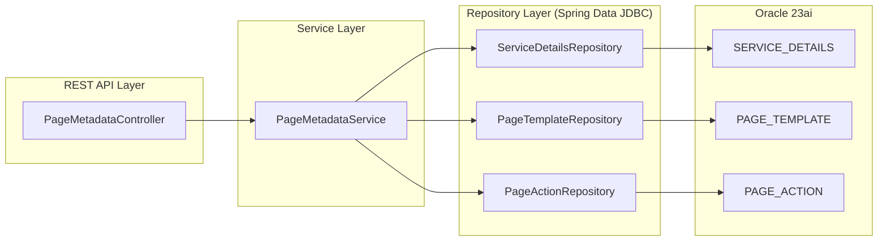

# SDUI Forge | Core Banking Gateway (core-sdui-gateway) — Phase 1 Deliverables

> **Status:** ✅ Compiled successfully | **Java 21** | **Spring Boot 3.4.1** | **Spring Data JDBC** | **Oracle 23ai**

---

## Architecture Overview



## File Index

| Layer | File | Purpose |
|-------|------|---------|
| **DDL** | [`V1__core_schema.sql`](file:///f:/Research/core-sdui-gateway/src/main/resources/db/migration/V1__core_schema.sql) | Oracle DDL with native `JSON` columns, identity PKs, self-referencing FK, indexes |
| **Config** | [`application.yml`](file:///f:/Research/core-sdui-gateway/src/main/resources/application.yml) | Virtual threads enabled, HikariCP tuned for Loom, Oracle datasource |
| **Config** | [`JdbcConfig.java`](file:///f:/Research/core-sdui-gateway/src/main/java/com/sdui/forge/config/JdbcConfig.java) | Custom converters for Oracle native JSON ↔ String |
| **Entity** | [`ServiceDetails.java`](file:///f:/Research/core-sdui-gateway/src/main/java/com/sdui/forge/domain/ServiceDetails.java) | Menu tree node entity (record) |
| **Entity** | [`PageTemplate.java`](file:///f:/Research/core-sdui-gateway/src/main/java/com/sdui/forge/domain/PageTemplate.java) | Page blueprint entity with JSON column |
| **Entity** | [`PageAction.java`](file:///f:/Research/core-sdui-gateway/src/main/java/com/sdui/forge/domain/PageAction.java) | Action metadata entity with JSON schema |
| **Repo** | [`ServiceDetailsRepository.java`](file:///f:/Research/core-sdui-gateway/src/main/java/com/sdui/forge/repository/ServiceDetailsRepository.java) | Oracle `CONNECT BY` hierarchical query |
| **Repo** | [`PageTemplateRepository.java`](file:///f:/Research/core-sdui-gateway/src/main/java/com/sdui/forge/repository/PageTemplateRepository.java) | Standard CRUD for page templates |
| **Repo** | [`PageActionRepository.java`](file:///f:/Research/core-sdui-gateway/src/main/java/com/sdui/forge/repository/PageActionRepository.java) | Single-query join to resolve actions by page ID |
| **Service** | [`PageMetadataService.java`](file:///f:/Research/core-sdui-gateway/src/main/java/com/sdui/forge/service/PageMetadataService.java) | O(n) tree assembly + composite blueprint builder |
| **Controller** | [`PageMetadataController.java`](file:///f:/Research/core-sdui-gateway/src/main/java/com/sdui/forge/controller/PageMetadataController.java) | Two GET endpoints |
| **DTO** | [`MenuNodeDto.java`](file:///f:/Research/core-sdui-gateway/src/main/java/com/sdui/forge/dto/MenuNodeDto.java) | Recursive menu tree response |
| **DTO** | [`PageBlueprintDto.java`](file:///f:/Research/core-sdui-gateway/src/main/java/com/sdui/forge/dto/PageBlueprintDto.java) | Composite blueprint + actions response |
| **DTO** | [`ApiErrorResponse.java`](file:///f:/Research/core-sdui-gateway/src/main/java/com/sdui/forge/dto/ApiErrorResponse.java) | RFC 7807 error envelope |
| **Exception** | [`ResourceNotFoundException.java`](file:///f:/Research/core-sdui-gateway/src/main/java/com/sdui/forge/exception/ResourceNotFoundException.java) | Domain exception → HTTP 404 |
| **Exception** | [`GlobalExceptionHandler.java`](file:///f:/Research/core-sdui-gateway/src/main/java/com/sdui/forge/exception/GlobalExceptionHandler.java) | Central error handler (no internals leaked) |

---

## API Contract

### `GET /sdui-forge/api/v1/menus`

Returns the hierarchical menu tree.

```json
[
  {
    "menuId": 1,
    "menuName": "Account Services",
    "pageId": null,
    "allowedRoles": "ROLE_TELLER,ROLE_MANAGER",
    "children": [
      {
        "menuId": 2,
        "menuName": "Account Opening",
        "pageId": 101,
        "allowedRoles": "ROLE_TELLER",
        "children": []
      }
    ]
  }
]
```

### `GET /sdui-forge/api/v1/pages/{pageId}/blueprint`

Returns the complete SDUI page configuration.

```json
{
  "pageId": 101,
  "pageTitle": "Account Opening Form",
  "layoutType": "FORM",
  "pageVersion": "1.2.0",
  "uiBlueprint": {
    "widgets": [ ... ],
    "layout": { ... }
  },
  "actions": [
    {
      "actionId": 1,
      "actionName": "Submit Application",
      "actionType": "API_CALL",
      "httpMethod": "POST",
      "targetEndpoint": "/api/v1/accounts",
      "targetWidget": "submitBtn",
      "jsonSchema": { ... }
    }
  ]
}
```

### Error Response (all endpoints)

```json
{
  "timestamp": "2026-10-14T15:34:46Z",
  "status": 404,
  "error": "Not Found",
  "message": "PageTemplate not found with identifier: 999",
  "path": "/sdui-forge/api/v1/pages/999/blueprint"
}
```

---

## Key Design Decisions

| Decision | Rationale |
|----------|-----------|
| **Java records for entities** | Immutable, zero-boilerplate, aligns with Spring Data JDBC's aggregate model |
| **Oracle `CONNECT BY` for hierarchy** | Single SQL round-trip; tree assembled in O(n) memory |
| **`JSON` native type (not `CLOB`)** | Oracle 23ai stores as binary OSON — faster indexing, JSON path queries, smaller footprint |
| **HikariCP pool size = 10** | Virtual threads don't pin platform threads; small pool avoids wasting Oracle server connections |
| **`Object` type for JSON in DTOs** | Jackson serializes as native JSON objects — no double-escaping the blueprint |
| **Single-query join in `PageActionRepository`** | Avoids N+1: resolves menu→actions in one SQL statement |
| **No JPA, no Hibernate** | Requirement constraint; direct SQL gives full control over query plans |

