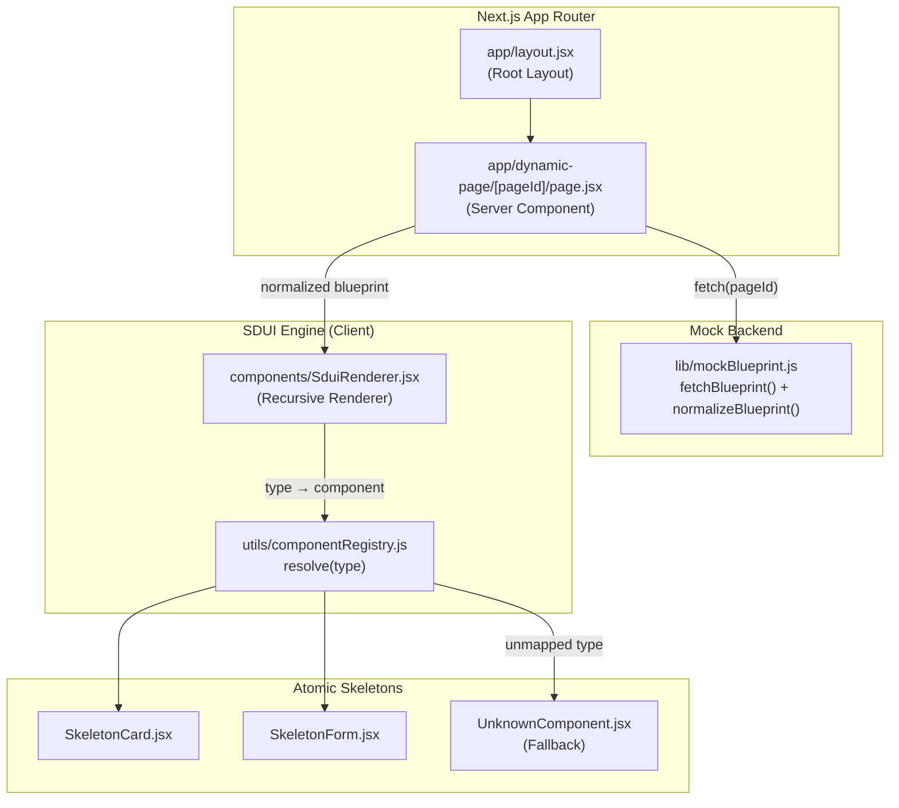
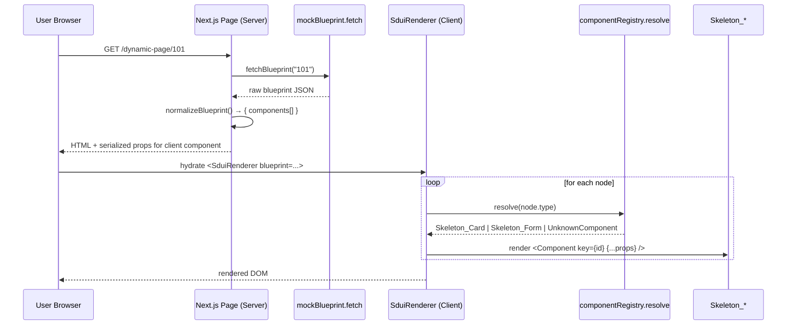

# SDUI Forge — Phase 2 Deliverables

> **Status:** ✅ Files scaffolded | **Next.js 14 (App Router)** | **React 18** | **JavaScript (ES6+ / JSX)** | **Tailwind CSS 3.4**
> **No TypeScript** — the renderer is plain JavaScript with defensive optional chaining and default values to keep malformed blueprints from white-screening the UI.

---

## Architecture Overview



---

## File Index

| Layer | File | Purpose |
|-------|------|---------|
| **Skeleton — Card** | [`frontend/components/skeletons/SkeletonCard.jsx`](file:///F:/Research/core-sdui-gateway/frontend/components/skeletons/SkeletonCard.jsx) | Pure presentational card. Defensive default props. |
| **Skeleton — Form** | [`frontend/components/skeletons/SkeletonForm.jsx`](file:///F:/Research/core-sdui-gateway/frontend/components/skeletons/SkeletonForm.jsx) | Dynamic form driven by `fields[]` array. Plain controlled state — RHF lands in Phase 3. |
| **Skeleton — Fallback** | [`frontend/components/skeletons/UnknownComponent.jsx`](file:///F:/Research/core-sdui-gateway/frontend/components/skeletons/UnknownComponent.jsx) | Rendered when a `type` is not in the registry. Logs warn, keeps the page alive. |
| **Registry** | [`frontend/utils/componentRegistry.js`](file:///F:/Research/core-sdui-gateway/frontend/utils/componentRegistry.js) | String → component map. `resolve(type)` returns either the matched component or the fallback. |
| **Engine** | [`frontend/components/SduiRenderer.jsx`](file:///F:/Research/core-sdui-gateway/frontend/components/SduiRenderer.jsx) | Recursive renderer. Stable `id`-based React keys, layout-aware wrapper, child recursion for nested containers. |
| **Mock Backend** | [`frontend/lib/mockBlueprint.js`](file:///F:/Research/core-sdui-gateway/frontend/lib/mockBlueprint.js) | In-memory mock of `GET /pages/{pageId}/blueprint`. Includes `normalizeBlueprint()` adapter that maps the live Phase-1 `uiBlueprint.widgets` shape to the renderer's `components[]` shape. |
| **App Router — Root** | [`frontend/app/layout.jsx`](file:///F:/Research/core-sdui-gateway/frontend/app/layout.jsx) | Root layout, Tailwind globals import, default metadata. |
| **App Router — Global CSS** | [`frontend/app/globals.css`](file:///F:/Research/core-sdui-gateway/frontend/app/globals.css) | Tailwind base/components/utilities directives. |
| **App Router — Page** | [`frontend/app/dynamic-page/[pageId]/page.jsx`](file:///F:/Research/core-sdui-gateway/frontend/app/dynamic-page/[pageId]/page.jsx) | Server Component. Fetches blueprint, normalizes payload, mounts `SduiRenderer`. Never throws — any fetch/parse failure becomes a friendly inline alert. |
| **Config** | [`frontend/package.json`](file:///F:/Research/core-sdui-gateway/frontend/package.json) | Next 14.2.5, React 18.3.1, Tailwind 3.4.7. No TypeScript. |
| **Config** | [`frontend/next.config.mjs`](file:///F:/Research/core-sdui-gateway/frontend/next.config.mjs) | Strict mode on. |
| **Config** | [`frontend/postcss.config.mjs`](file:///F:/Research/core-sdui-gateway/frontend/postcss.config.mjs) | Tailwind + Autoprefixer. |
| **Config** | [`frontend/tailwind.config.js`](file:///F:/Research/core-sdui-gateway/frontend/tailwind.config.js) | `content` globs `./app/**` and `./components/**`. Banking-neutral `brand` palette. |
| **Config** | [`frontend/jsconfig.json`](file:///F:/Research/core-sdui-gateway/frontend/jsconfig.json) | `@/*` path alias to project root. |
| **Config** | [`frontend/.gitignore`](file:///F:/Research/core-sdui-gateway/frontend/.gitignore) | Standard Next.js ignores. |

---

## Rendering Pipeline



---

## Blueprint Contract

This phase honours the **user-supplied example shape** (authoritative for Phase 2):

```json
{
  "pageTitle": "Customer Dashboard",
  "layoutType": "VERTICAL_STACK",
  "components": [
    {
      "type": "Skeleton_Card",
      "id": "info_card_1",
      "props": { "title": "Account Info", "content": "Enter details below." }
    },
    {
      "type": "Skeleton_Form",
      "id": "search_form_1",
      "props": {
        "fields": [
          { "name": "accountNo", "label": "Account Number", "inputType": "text", "required": true }
        ],
        "actionId": 101
      }
    }
  ]
}
```

> **Note on Phase-1 contract:** The live Phase-1 endpoint (`GET /sdui-forge/api/v1/pages/{pageId}/blueprint`) actually nests UI nodes under `uiBlueprint.widgets`, not the flat `components` array used above. `lib/mockBlueprint.js → normalizeBlueprint()` bridges the two — if the raw payload lacks `components` but has `uiBlueprint.widgets`, it is folded into the shape the renderer expects. When the real backend is wired in (just replace `fetchBlueprint` with a real `fetch`), no renderer changes are required.

---

## Key Design Decisions

| Decision | Rationale |
|----------|-----------|
| **Plain JavaScript, no TypeScript** | Team leverage on existing MERN expertise; no `.d.ts` overhead. Safety comes from default params, optional chaining, and array coercion. |
| **String-keyed registry over switch/case** | O(1) lookup, trivial to extend in later phases (add a component + one map entry, done). |
| **`resolve(type)` never throws** | The single most important safety property — an unmapped `type` from a backend bug renders a friendly fallback instead of crashing the page. |
| **Server/Client split** | `app/dynamic-page/[pageId]/page.jsx` is a Server Component (fetch + serialize). `SduiRenderer` and `SkeletonForm` are Client Components (`"use client"`) because the form uses hooks. App Router supports this natively for serializable props. |
| **Stable `id`-based React keys** | Backend-supplied `id` is preferred for reconciliation; falls back to `type+index` only if missing. Keeps the Virtual DOM diff cheap and prevents remount on re-render. |
| **Recursive `renderNode()`** | The engine recurses into a node's own `children` array (if present) and passes them via React `children`. Future-proof for nested layouts without a second-pass refactor. |
| **Layout wrapper is data-driven** | `layoutType` selects a Tailwind wrapper (`VERTICAL_STACK` / `HORIZONTAL_STACK` / `GRID`). New layouts are one switch case — no engine rewrite. |
| **Input-type whitelist in `SkeletonForm`** | Backend-supplied `inputType` is validated against an allow-list before reaching the DOM. Prevents a hostile or buggy payload from injecting uncontrolled variants. |
| **Try/catch in the Server Component** | A 404, network error, or JSON parse failure becomes a red inline alert — the route itself never 500s. |
| **No new dependencies** beyond `next`, `react`, `react-dom`, `tailwindcss`, `postcss`, `autoprefixer`. Keeps the bundle small and the supply surface minimal. |

---

## Local Run

```bash
cd frontend
npm install
npm run dev
```

Then visit:

| URL | What you see |
|-----|--------------|
| `http://localhost:3000/dynamic-page/101` | Happy path: page title, one card, one form with `accountNo` + `branchCode` fields. |
| `http://localhost:3000/dynamic-page/999` | Fallback demo: a good card plus the `Skeleton_Table` fallback (not registered). |
| `http://localhost:3000/dynamic-page/404` | Inline red alert — the mock throws, the page still renders. |

---

## What is **not** in this phase

- **React Hook Form + Zod** for validation — lands in Phase 3.
- **Action dispatch** (`actionId` → `PageAction` lookup → real API call) — Phase 3.
- **Auth / role-gated rendering** based on `PAGE_TEMPLATE.allowedRoles` — later phase.
- **Menu tree consumption** (`GET /sdui-forge/api/v1/menus`) — later phase.
- **New widget types** (Table, Chart, Modal, …) — added incrementally to the registry as the backend exposes them.
