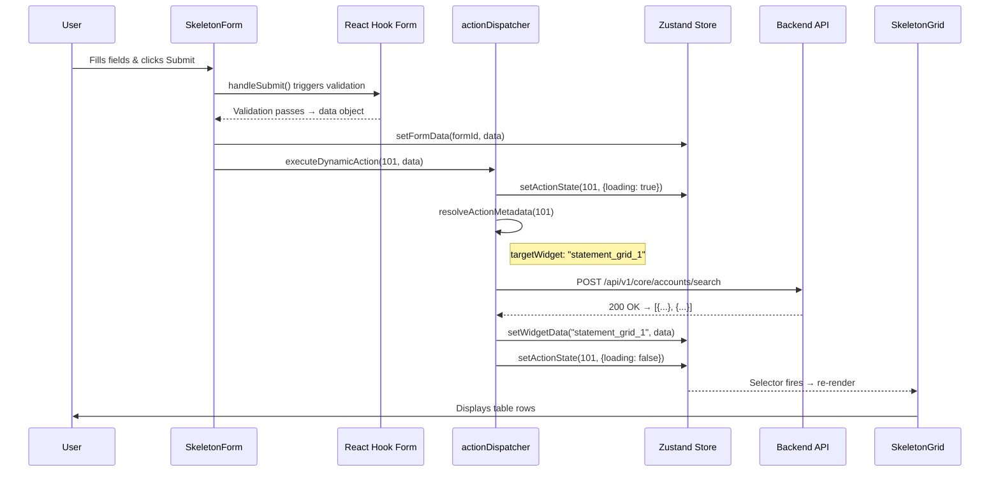

# SDUI Forge — Phase 3 Deliverables

> **Status:** ✅ Build passed (0 errors) | **Zustand** | **React Hook Form** | **Next.js 14** | **JavaScript**

---

## Architecture: Phase 3 Data Flow



## File Index

| # | File | Purpose |
|---|------|---------|
| 1 | [`useSduiStore.js`](file:///f:/Research/core-sdui-gateway/frontend/store/useSduiStore.js) | Zustand store: `formData`, `widgetData`, `actionStates` |
| 2 | [`SkeletonForm.jsx`](file:///f:/Research/core-sdui-gateway/frontend/components/skeletons/SkeletonForm.jsx) | React Hook Form upgrade — dynamic validation from blueprint `rules` |
| 3 | [`actionDispatcher.js`](file:///f:/Research/core-sdui-gateway/frontend/utils/actionDispatcher.js) | Central action execution: metadata resolve → fetch → store update |
| 4 | [`SkeletonGrid.jsx`](file:///f:/Research/core-sdui-gateway/frontend/components/skeletons/SkeletonGrid.jsx) | Data-bound grid — subscribes to `widgetData[id]` |
| 5 | [`componentRegistry.js`](file:///f:/Research/core-sdui-gateway/frontend/utils/componentRegistry.js) | Updated: registered `Skeleton_Grid` |
| 6 | [`SduiRenderer.jsx`](file:///f:/Research/core-sdui-gateway/frontend/components/SduiRenderer.jsx) | Updated: passes blueprint node `id` as prop to components |
| 7 | [`mockBlueprint.js`](file:///f:/Research/core-sdui-gateway/frontend/lib/mockBlueprint.js) | Updated: Phase 3 rules + Skeleton_Grid in page 101 |
| 8 | [`route.js`](file:///f:/Research/core-sdui-gateway/frontend/app/api/v1/core/accounts/search/route.js) | Mock API returning statement data for end-to-end demo |

---

## Zustand Store Shape

```js
{
  formData: {
    "search_form_1": { accountNo: "1234567890123", branchCode: "BR001" }
  },
  widgetData: {
    "statement_grid_1": [
      { id: 1, transactionDate: "2026-10-01", description: "...", ... }
    ]
  },
  actionStates: {
    101: { loading: false, error: null }
  }
}
```

## Dynamic Validation Rules Supported

| Rule Key | Type | Example | RHF Mapping |
|----------|------|---------|-------------|
| `required` | `boolean \| string` | `true` | `{ required: "Label is required" }` |
| `minLength` | `number` | `13` | `{ minLength: { value: 13, message: "..." } }` |
| `maxLength` | `number` | `10` | `{ maxLength: { value: 10, message: "..." } }` |
| `pattern` | `string` (regex) | `"^\\d+$"` | `{ pattern: { value: /^\d+$/, message: "..." } }` |
| `min` | `number` | `0` | `{ min: { value: 0, message: "..." } }` |
| `max` | `number` | `999999` | `{ max: { value: 999999, message: "..." } }` |

## Key Design Decisions

| Decision | Rationale |
|----------|-----------|
| **Single Zustand store** | Banking pages rarely exceed ~20 widgets; a single flat store with selectors is simpler and faster than multiple stores |
| **`widgetData` keyed by widget ID** | Decouples the action dispatcher from the rendering layer — any widget can subscribe to any key |
| **React Hook Form `mode: "onBlur"`** | Validates when user leaves a field — better UX than onChange (less noise) while still catching errors before submit |
| **`buildValidation()` function** | Translates backend JSON rules into RHF format in one place; wraps `new RegExp()` in try/catch to survive malformed patterns |
| **`Object` type for uiBlueprint/jsonSchema in DTOs** | Raw JSON passthrough — frontend engine gets a traversable tree, never an escaped string |
| **Mock API as Next.js Route Handler** | End-to-end demo without backend dependency; delete when real Spring Boot API is connected |
| **Optional chaining everywhere** | Safety requirement — app never crashes on missing/malformed backend JSON |

