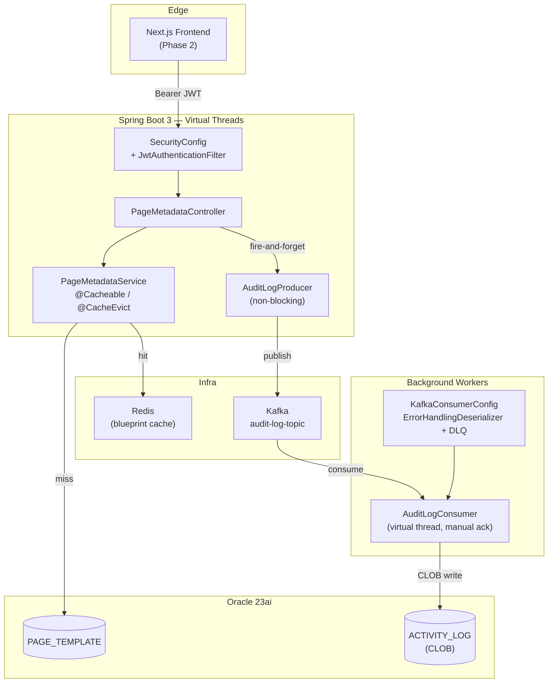
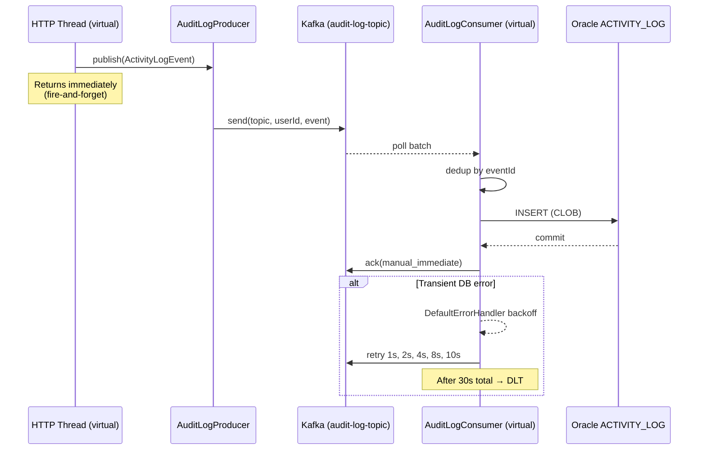
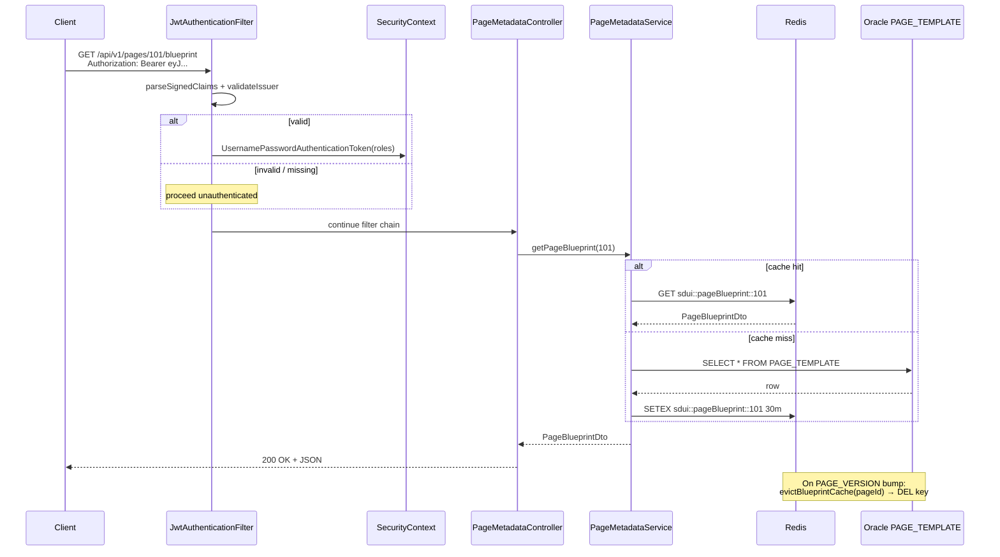

# SDUI Forge | Core Banking Gateway (core-sdui-gateway) — Phase 4 Deliverables

> **Status:** ✅ Compiles cleanly | **Spring Boot 3.4.1** | **Java 21 (Loom virtual threads)** | **Spring Data JDBC** | **Spring Security + JWT** | **Spring Data Redis (Lettuce)** | **Spring Kafka** | **Oracle 23ai**

---

## Architecture Overview



---

## File Index

### New (Phase 4)

| Layer | File | Purpose |
|-------|------|---------|
| **Config — Kafka** | [`src/main/java/com/sdui/forge/config/KafkaConsumerConfig.java`](file:///F:/Research/core-sdui-gateway/src/main/java/com/sdui/forge/config/KafkaConsumerConfig.java) | Dedicated consumer factory + listener container. `ErrorHandlingDeserializer` (poison-pill safety), `DefaultErrorHandler` with exponential backoff + DLQ, `MANUAL_IMMEDIATE` ack. |
| **Audit — Consumer** | [`src/main/java/com/sdui/forge/audit/AuditLogConsumer.java`](file:///F:/Research/core-sdui-gateway/src/main/java/com/sdui/forge/audit/AuditLogConsumer.java) | Persists `ActivityLogEvent` → Oracle `ACTIVITY_LOG`. Idempotent on `event_id`; validation errors ack-and-skip; transient DB errors throw → retry/DLQ. |
| **Domain** | [`src/main/java/com/sdui/forge/domain/ActivityLog.java`](file:///F:/Research/core-sdui-gateway/src/main/java/com/sdui/forge/domain/ActivityLog.java) | Record mapped to `ACTIVITY_LOG`. `ACT_LOG_PAYLOAD` is a CLOB at the column level; bound as `String`. |
| **Repository** | [`src/main/java/com/sdui/forge/repository/ActivityLogRepository.java`](file:///F:/Research/core-sdui-gateway/src/main/java/com/sdui/forge/repository/ActivityLogRepository.java) | Extends `CrudRepository`. Adds `findByActLogEventId` for idempotent insert. |
| **DDL** | [`src/main/resources/db/migration/V2__activity_log.sql`](file:///F:/Research/core-sdui-gateway/src/main/resources/db/migration/V2__activity_log.sql) | `ACTIVITY_LOG` table with CLOB payload, unique index on event id, four lookup indexes. |

### Existing (carried forward, integrated)

| Layer | File | Purpose |
|-------|------|---------|
| **Config — Redis** | [`src/main/java/com/sdui/forge/config/RedisCacheConfig.java`](file:///F:/Research/core-sdui-gateway/src/main/java/com/sdui/forge/config/RedisCacheConfig.java) | Named caches with per-cache TTL (blueprint 30m, menu 60m), JSON values, key prefixing, transaction-aware. |
| **Service** | [`src/main/java/com/sdui/forge/service/PageMetadataService.java`](file:///F:/Research/core-sdui-gateway/src/main/java/com/sdui/forge/service/PageMetadataService.java) | `@Cacheable` reads + `@CacheEvict` (per-page, all, menu-tree) for `PAGE_VERSION` bumps. |
| **Security** | [`src/main/java/com/sdui/forge/security/SecurityConfig.java`](file:///F:/Research/core-sdui-gateway/src/main/java/com/sdui/forge/security/SecurityConfig.java) | Stateless JWT filter chain, `/api/v1/auth/**` public, `/api/v1/pages/**`, `/api/v1/menus/**`, `/api/v1/core/**` require JWT. |
| **Security** | [`src/main/java/com/sdui/forge/security/JwtAuthenticationFilter.java`](file:///F:/Research/core-sdui-gateway/src/main/java/com/sdui/forge/security/JwtAuthenticationFilter.java) | Once-per-request Bearer extraction, role authorities, security context population. |
| **Security** | [`src/main/java/com/sdui/forge/security/JwtTokenProvider.java`](file:///F:/Research/core-sdui-gateway/src/main/java/com/sdui/forge/security/JwtTokenProvider.java) | JJWT 0.12 HMAC-SHA256, reusable parser, claim extraction. |
| **Security** | [`src/main/java/com/sdui/forge/security/JwtAuthenticationEntryPoint.java`](file:///F:/Research/core-sdui-gateway/src/main/java/com/sdui/forge/security/JwtAuthenticationEntryPoint.java) | JSON RFC-7807 401 envelope for API consumers. |
| **Audit — Event** | [`src/main/java/com/sdui/forge/audit/ActivityLogEvent.java`](file:///F:/Research/core-sdui-gateway/src/main/java/com/sdui/forge/audit/ActivityLogEvent.java) | Immutable record published to Kafka. |
| **Audit — Producer** | [`src/main/java/com/sdui/forge/audit/AuditLogProducer.java`](file:///F:/Research/core-sdui-gateway/src/main/java/com/sdui/forge/audit/AuditLogProducer.java) | Non-blocking publish keyed by `userId` for per-user ordering. |
| **Config** | [`src/main/resources/application.yml`](file:///F:/Research/core-sdui-gateway/src/main/resources/application.yml) | Virtual threads, Redis, Kafka, JWT, HikariCP, logging. |
| **DDL** | [`src/main/resources/db/migration/V1__core_schema.sql`](file:///F:/Research/core-sdui-gateway/src/main/resources/db/migration/V1__core_schema.sql) | `SERVICE_DETAILS`, `PAGE_TEMPLATE`, `PAGE_ACTION` (Phase 1). |

---

## Async Audit Pipeline



---

## Security & Caching Flow



---

## Key Design Decisions

| Decision | Rationale |
|----------|-----------|
| **Virtual threads (Project Loom)** | `spring.threads.virtual.enabled=true` lets Tomcat and the Kafka listener container multiplex millions of in-flight requests without platform-thread pinning. Pairs naturally with I/O-bound work (CLOB writes, Redis). |
| **Stateless JWT, no sessions** | Horizontally scalable; CSRF is not applicable; per-request filter is a single `OncePerRequestFilter` instance. |
| **Method-level security** | `@EnableMethodSecurity` enables `@PreAuthorize("hasRole('MAKER')")` on controllers/services without polluting the filter chain. |
| **Named Redis caches with per-TTL** | `pageBlueprint` is hot (30m) — menu tree changes less (60m). Spring's `RedisCacheManager` accepts a per-name `Map<String, RedisCacheConfiguration>`. |
| **Key prefixing + transaction-aware** | `sdui::pageBlueprint::{id}` avoids collisions in shared Redis; `transactionAware()` rolls back cache puts on a failed transaction. |
| **`@CacheEvict` for `PAGE_VERSION`** | Single-point cache invalidation: bump version → call `evictBlueprintCache(pageId)` → next read repopulates from Oracle. |
| **Kafka decoupling for audit** | CLOB writes (often MB-scale) cannot run on the request thread. Kafka absorbs bursts; the consumer is independently scalable. |
| **Idempotency on `eventId`** | UUID assigned at publish time; consumer dedupes via `findByActLogEventId`. Makes at-least-once delivery safe. |
| **Manual ack, immediate mode** | `MANUAL_IMMEDIATE` ties offset commit to successful DB commit — no loss on consumer crash mid-batch. |
| **`ErrorHandlingDeserializer` wrapper** | A single malformed payload cannot terminate the listener thread — the wrapper catches and routes to DLT. |
| **Exponential backoff + DLQ** | 1s→2s→4s→8s→10s, 30s total cap, then `audit-log-topic.DLT`. `IllegalArgumentException` is non-retryable to short-circuit poison pills. |
| **No Hibernate, only Spring Data JDBC** | Direct SQL control; transparent Oracle `JSON` ↔ `String` conversion via `JdbcConfig` converters. |
| **HMAC-SHA256, 256-bit minimum secret** | Symmetric, fast, sufficient for internal service-to-service auth. Secret injected via `SDUI_JWT_SECRET` env var. |

---

## Failure Modes & Guarantees

| Failure | Behaviour |
|---------|-----------|
| **Invalid / missing JWT** | Filter proceeds unauthenticated → SecurityConfig returns 401 via `JwtAuthenticationEntryPoint` (JSON envelope). |
| **Cache miss** | Read from Oracle, populate Redis, return. No failure path. |
| **Redis down** | Lettuce throws; `CacheErrorHandler` (default) logs and continues to DB. Reads degrade, never fail. |
| **Oracle down (read)** | 5xx via `GlobalExceptionHandler`; cache holds last good value. |
| **Kafka producer failure** | Logged, callback returns — main request is unaffected. Event lost (acceptable for non-critical audit; wire to alert for visibility). |
| **Kafka consumer — poison pill** | `ErrorHandlingDeserializer` captures, error handler routes to DLT after `IllegalArgumentException` (non-retryable). |
| **Kafka consumer — transient DB error** | Exponential backoff retry (1s→2s→4s→8s→10s, 30s total), then DLT. Offset not committed until success. |
| **Kafka consumer — duplicate redelivery** | `findByActLogEventId` returns existing → ack and skip. |
| **CLOB write hangs** | Virtual thread yields; HikariCP `leak-detection-threshold: 30s` flags held connections. |

---

## Endpoint Contract (Phase 4)

| Endpoint | Auth | Role required | Cached |
|----------|------|---------------|--------|
| `POST /api/v1/auth/login` | public | — | — |
| `GET  /api/v1/menus` | JWT | any authenticated | 60m |
| `GET  /api/v1/pages/{pageId}/blueprint` | JWT | any authenticated | 30m (per page) |
| `GET  /api/v1/core/**` | JWT | role-gated via `@PreAuthorize` | n/a |
| `GET  /actuator/health` | public | — | — |
| `GET  /actuator/info` | public | — | — |

---

## Local Run (Phase 4 prerequisites)

```bash
# 1. Start infra (assume Docker locally)
docker run -d --name redis -p 6379:6379 redis:7
docker run -d --name kafka -p 9092:9092 \
  -e KAFKA_NODE_ID=1 -e KAFKA_PROCESS_ROLES=broker,controller \
  -e KAFKA_LISTENERS=PLAINTEXT://0.0.0.0:9092,CONTROLLER://0.0.0.0:9093 \
  -e KAFKA_ADVERTISED_LISTENERS=PLAINTEXT://localhost:9092 \
  apache/kafka:3.7.0

# 2. Apply migrations
mvn flyway:migrate   # or run V1__core_schema.sql + V2__activity_log.sql manually

# 3. Start the gateway
mvn spring-boot:run

# 4. Smoke test
curl -H "Authorization: Bearer <token>" http://localhost:8080/sdui-forge/api/v1/pages/101/blueprint
```

---

## What is **not** in this phase

- **Refresh tokens** — single-token flow with 24h expiry.
- **mTLS / OAuth2 introspection** — symmetric JWT only.
- **Schema registry** — Kafka payload schema is implicit (Java record).
- **CDC / outbox** — sync DB write to `PAGE_TEMPLATE` does not yet publish an invalidate event for multi-instance cache coherence (works in single-instance; for multi-instance, add Redis pub/sub or Kafka cache-invalidation topic in a later phase).
- **Rate limiting** — defer to API gateway layer.
- **Distributed tracing** — defer to OpenTelemetry auto-instrumentation phase.

---

## Compilation Verification

```bash
mvn -DskipTests compile
# [INFO] BUILD SUCCESS
```
