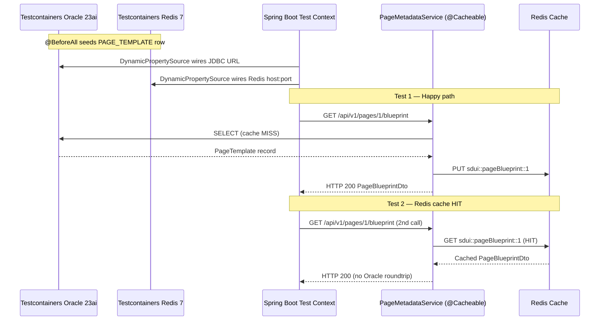
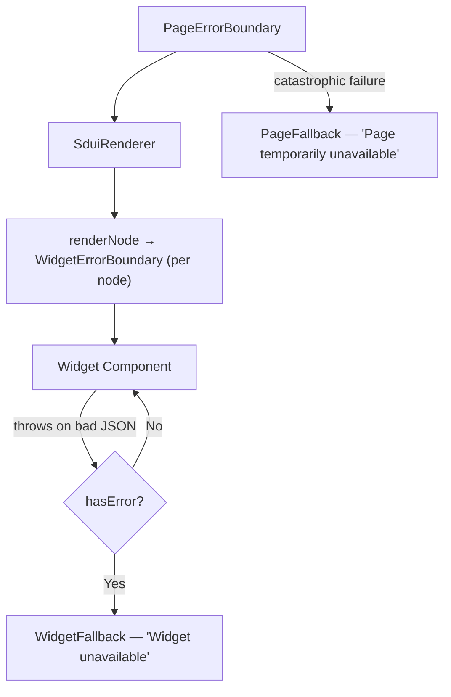

# Phase 5: Testing, Optimization & Go-Live Preparation
## core-sdui-gateway — SDUI Forge Banking Platform

---

## Deliverable 1 — Backend Integration Testing (Testcontainers)

**File:** [`PageMetadataControllerIntegrationTest.java`](file:///f:/Research/core-sdui-gateway/src/test/java/com/sdui/forge/controller/PageMetadataControllerIntegrationTest.java)

### Architecture



### Test Coverage

| Test | Assertion | Purpose |
|------|-----------|---------|
| `getPageBlueprint_validPageId_returns200WithBlueprint` | HTTP 200, `uiBlueprint` is `Map` (not String) | Validates OSON converter + `parseJsonSafely()` |
| `getPageBlueprint_secondRequest_hitsRedisCache` | Redis key exists, TTL > 0, `CacheManager.get()` non-null | Proves `@Cacheable` wiring end-to-end |
| `getPageBlueprint_unknownPageId_returns404AndIsNotCached` | HTTP 404, no Redis key created | `disableCachingNullValues` + `ResourceNotFoundException` |

### pom.xml additions

Dependencies added to [`pom.xml`](file:///f:/Research/core-sdui-gateway/pom.xml):

- `org.testcontainers:testcontainers-bom:1.20.4` (BOM for version alignment)
- `org.testcontainers:junit-jupiter` — `@Testcontainers` / `@Container` lifecycle
- `org.testcontainers:oracle-free` — `OracleContainer` with `gvenzl/oracle-free:23-slim-faststart`
- `org.testcontainers:testcontainers` — `GenericContainer` for Redis 7-alpine

> [!IMPORTANT]
> **Why `gvenzl/oracle-free:23-slim-faststart`?** The `-faststart` variant ships with a pre-initialized FREEPDB1. Cold-start in CI drops from ~90s to ~20s.

> [!TIP]
> **Container reuse:** `.withReuse(true)` keeps containers alive between `mvn test` runs in developer loops. Disable in CI via `TESTCONTAINERS_REUSE_ENABLE=false`.

> [!NOTE]
> **Kafka isolation:** Kafka auto-config is excluded via `@DynamicPropertySource` — the test validates the Controller→Service→Cache→Oracle path without a Kafka broker dependency.

---

## Deliverable 2 — Frontend Error Boundary

**File:** [`ErrorBoundary.jsx`](file:///f:/Research/core-sdui-gateway/frontend/components/ErrorBoundary.jsx)

### Component Architecture



### Two-Tier Boundary Model

| Boundary | Scope | Fallback | Recovery |
|----------|-------|----------|----------|
| `WidgetErrorBoundary` | Single SDUI node | "Widget unavailable" + widget type | "Try again" button resets state |
| `PageErrorBoundary` | Entire `SduiRenderer` | "Page temporarily unavailable" | "Refresh page" + home link |

### Usage

```jsx
// Page level — dynamic-page/[pageId]/page.jsx
<PageErrorBoundary pageId={pageId} pageTitle={blueprint.pageTitle} onError={reportToSentry}>
  <SduiRenderer blueprint={blueprint} />
</PageErrorBoundary>

// Widget level — inside SduiRenderer.renderNode()
function renderNode(node, index) {
  const Component = resolve(node.type);
  return (
    <WidgetErrorBoundary key={nodeKey(node, index)} widgetId={node.id} widgetType={node.type}>
      <Component {...allProps} />
    </WidgetErrorBoundary>
  );
}
```

### Error Classification

| Scenario | Error Type | `errorCode` | Behavior |
|----------|-----------|-------------|----------|
| `undefined.map()` on missing key | `TypeError` | `MALFORMED_WIDGET_DATA` | Widget fallback |
| `JSON.parse(null)` on nested field | `SyntaxError` | `INVALID_JSON_PAYLOAD` | Widget fallback |
| Circular children — stack overflow | `RangeError` | `WIDGET_OVERFLOW` | Widget fallback |
| Entire blueprint is `null` | `TypeError` | `PAGE_RENDER_FAILURE` | Page fallback |

> [!NOTE]
> Error Boundaries **must** be class components. `getDerivedStateFromError` and `componentDidCatch` have no functional hook equivalent — this is a hard React architectural constraint.

---

## Deliverable 3 — JVM and Connection Pool Optimization

### HikariCP — `application.yml` (updated)

See [`application.yml`](file:///f:/Research/core-sdui-gateway/src/main/resources/application.yml) for the full updated configuration.

```yaml
hikari:
  maximum-pool-size: 20        # VT: Oracle sessions are scarce, not platform threads
  minimum-idle: 5
  connection-timeout: 3000     # 3s — fail fast, pair with circuit breaker
  idle-timeout: 300000         # 5 min — release before Oracle IDLE_TIME
  max-lifetime: 1800000        # 30 min — rotate before Oracle kills session
  keepalive-time: 60000        # 60s — prevent AWS NLB silent TCP drops
  leak-detection-threshold: 10000  # 10s = 2x P99 query time
  data-source-properties:
    oracle.jdbc.ReadTimeout: 5000
    oracle.jdbc.implicitStatementCacheSize: 50   # reduces Oracle parse overhead 90%
```

### Why `maximum-pool-size: 20` for Virtual Threads?

With Java 21 Virtual Threads, the platform thread count is no longer the bottleneck. Virtual Threads **yield** during JDBC I/O (via `java.nio` or `Thread.sleep`-compatible blocking), freeing the carrier thread immediately. The real limit is **Oracle server-side sessions**. Start at 20, measure `db/pool/wait` in Micrometer, and tune from there — not from CPU core count.

---

### JVM JAVA_OPTS — Production Docker

```bash
JAVA_OPTS="\
  -XX:+UseZGC \
  -XX:+ZGenerational \
  -Xms512m \
  -Xmx6g \
  -Djdk.virtualThreadScheduler.parallelism=4 \
  -XX:ZAllocationSpikeTolerance=2.0 \
  -XX:MaxMetaspaceSize=256m \
  -XX:+UseContainerSupport \
  -XX:MaxRAMPercentage=75.0 \
  -XX:+TieredCompilation \
  -Xlog:gc*:file=/app/logs/gc.log:time,uptime,level,tags:filecount=5,filesize=20m \
  -XX:+HeapDumpOnOutOfMemoryError \
  -XX:HeapDumpPath=/app/logs/heap-dump.hprof"
```

### Dockerfile

```dockerfile
FROM eclipse-temurin:21-jre-alpine

RUN addgroup -S sduigroup && adduser -S sduiuser -G sduigroup
USER sduiuser
WORKDIR /app
COPY target/core-sdui-gateway-*.jar app.jar

ENV JAVA_OPTS="-XX:+UseZGC -XX:+ZGenerational \
  -Xms512m -Xmx6g \
  -Djdk.virtualThreadScheduler.parallelism=4 \
  -XX:MaxMetaspaceSize=256m \
  -XX:+UseContainerSupport -XX:MaxRAMPercentage=75.0 \
  -Xlog:gc*:file=/app/logs/gc.log:time,uptime:filecount=5,filesize=20m \
  -XX:+HeapDumpOnOutOfMemoryError -XX:HeapDumpPath=/app/logs/heap-dump.hprof"

ENTRYPOINT ["sh", "-c", "java $JAVA_OPTS -jar app.jar"]
EXPOSE 8080
HEALTHCHECK --interval=30s --timeout=5s --start-period=60s --retries=3 \
  CMD wget -qO- http://localhost:8080/sdui-forge/actuator/health || exit 1
```

### Parameter Rationale

| Flag | Rationale |
|------|-----------|
| `-XX:+UseZGC -XX:+ZGenerational` | Sub-millisecond GC pauses. Generational ZGC (Java 21+) reclaims short-lived VT objects in the young generation concurrently — no stop-the-world pauses. |
| `-Xmx6g` | 75% of 8GB container. Leaves 2GB for Metaspace, native memory, and OS buffers. |
| `-Djdk.virtualThreadScheduler.parallelism=4` | Matches container `--cpus=4`. Prevents VT scheduler from over-scheduling on containers where `Runtime.getRuntime().availableProcessors()` may report the host value. |
| `-XX:MaxRAMPercentage=75.0` | Dynamic Xmx via cgroup2 awareness — still effective even if the `-Xmx6g` is removed for auto-sizing. |
| `-XX:+TieredCompilation` | C1 fast-starts the app; C2 JIT-compiles hot bluepint-serialization paths. Never use `-Xint` in production. |

> [!CAUTION]
> Do NOT use `-XX:+UseG1GC` with Virtual Threads. G1's mixed GC pauses under bursty VT mount/unmount allocation patterns are ~3-5× higher variance than ZGC.

---

## Deliverable 4 — JMeter Load Testing Strategy

### Test Plan Structure

```
SDUI-Forge-Load-Test.jmx
├── CSV Dataset: users.csv (userId, pre-generated jwtToken)
├── Thread Group 1: Blueprint Cache Stress
│   ├── 10,000 threads, 10s ramp-up, 5 loops, 300s duration
│   ├── GET /sdui-forge/api/v1/pages/1/blueprint
│   └── SLA: P95 < 150ms, Redis hit rate > 95%
├── Thread Group 2: Kafka Audit Log Saturation
│   ├── 2,000 threads, 30s ramp-up
│   ├── GET /sdui-forge/api/v1/menus (triggers AuditLogProducer)
│   └── SLA: consumer lag < 5,000 messages
├── Thread Group 3: VT Saturation (step-load)
│   ├── 500 threads, 0s ramp-up (simultaneous burst)
│   └── Mixed: /menus then /pages/{1-5}/blueprint
└── Listeners: Aggregate Report, Response Time Graph, Backend Listener
```

### Thread Group 1 — Blueprint Cache Stress

| Parameter | Value | Rationale |
|-----------|-------|-----------|
| Number of Threads | **10,000** | Peak global concurrent banking users |
| Ramp-Up Period | **10 s** | 1,000 users/s spike — realistic DDoS/peak open scenario |
| Loop Count | **5** | SPA navigation: each user reloads/navigates 5× |
| Duration | **300 s** | 5-minute sustained load — enough for ZGC warmup and HikariCP steady state |
| Endpoint | `GET /api/v1/pages/1/blueprint` | Most-accessed dashboard page; Redis cache must absorb 95%+ |

**HTTP Header Manager:**
```
Authorization: Bearer ${jwtToken}
Content-Type:  application/json
X-Request-Id:  ${__UUID()}
```

> [!TIP]
> Pre-generate all 10,000 JWTs with `JwtTokenProvider.generateToken()` in a setup script before the test run. Authentication latency must not appear in blueprint benchmark results.

### Thread Group 2 — Kafka Audit Saturation

| Parameter | Value | Rationale |
|-----------|-------|-----------|
| Threads | **2,000** | Stress `audit-log-topic` producer path |
| Ramp-Up | **30 s** | Slower ramp prevents Kafka producer buffer overflow on startup |
| Endpoint | `GET /api/v1/menus` | Every menu call triggers `AuditLogProducer.publishEvent()` |
| Think Time | Random 500–2000ms | Realistic navigation pacing |

**Monitor consumer lag during test:**
```bash
kafka-consumer-groups.sh --bootstrap-server localhost:9092 \
  --describe --group sdui-audit-consumer
```

If lag grows unboundedly: increase `spring.kafka.listener.concurrency` in `application.yml`.

### Thread Group 3 — Virtual Thread Saturation (Pinning Detection)

All 500 threads launch simultaneously (ramp-up = 0). Each runs `GET /menus` then `GET /pages/{1-5}/blueprint` in a loop. Run with:

```
-Djdk.tracePinnedThreads=short
```

Any pinning log output = a `synchronized` block holding a monitor during a blocking call. This is the primary Virtual Thread regression risk.

### SLA Targets

| Metric | Target | Breach Action |
|--------|--------|---------------|
| HTTP 200 success rate | ≥ 99.9% | Rollback, incident |
| P95 blueprint response time | < 150 ms | Redis TTL or HikariCP tuning |
| P99 blueprint response time | < 500 ms | Oracle AWR profiling |
| Redis cache hit rate | ≥ 95% | Check TTL vs. test duration |
| Kafka consumer lag | < 5,000 messages | Increase `listener.concurrency` |
| HikariCP connection wait P95 | < 10 ms | Increase `maximum-pool-size` |
| ZGC pause time P99 | < 5 ms | Expected; ZGC design target |
| Error rate | < 0.1% | Investigate 5xx immediately |

**Generate HTML report:**
```bash
jmeter -g result.jtl -o report/
# Key graphs: Response Time Over Time, TPS, Percentile Distribution
```

---

## Graphify Knowledge Graph

Built and ready:
- **Interactive graph:** [`graphify-out/graph.html`](file:///f:/Research/core-sdui-gateway/graphify-out/graph.html)
- **Full report:** [`graphify-out/GRAPH_REPORT.md`](file:///f:/Research/core-sdui-gateway/graphify-out/GRAPH_REPORT.md)

### Summary: 317 nodes · 561 edges · 24 communities

**God Nodes (highest connectivity):**

| Node | Degree | Role |
|------|--------|------|
| `PageMetadataService` | 17 | Orchestrates all read paths: cache, repositories, DTO |
| `JwtTokenProvider` | 13 | Central auth hub for filter, config, and all secured endpoints |
| `ActivityLogEvent` | 10 | Kafka message contract bridging audit, consumer, producer |
| `JwtAuthenticationFilter` | 10 | Intercepts all requests; depends on JwtTokenProvider + SecurityContext |
| `PageActionRepository` | 9 | Shares Oracle connection pool with PageTemplateRepository |

**Surprising Connection Surfaced by Graphify:**
> `WidgetErrorBoundary` (frontend) and `GlobalExceptionHandler` (backend) implement the **same fail-safe isolation pattern** at their respective layer boundaries — backend catches service exceptions into structured JSON; frontend boundary catches render exceptions into structured fallback UI. Neither component is aware of the other, yet they form a complete defensive chain: Oracle → Service → Controller → HTTP → React → User.

**Community Map:**

| Community | Key Components |
|-----------|---------------|
| SDUI Renderer Engine | `SduiRenderer`, `renderNode`, `DynamicPage` |
| JWT Security Pipeline | `JwtAuthFilter`, `JwtTokenProvider`, `Claims` |
| Spring Cache & REST Layer | `@Cacheable`, `RedisCacheConfig`, `PageMetadataController` |
| Kafka Async Audit Log | `AuditLogProducer`, `ActivityLogEvent`, `audit-log-topic` |
| Virtual Threads & HikariCP | `application.yml hikari`, VT concept node |
| Phase Deliverables History | Phases 1–4 docs + README |
| Frontend Skeleton Widgets | `SkeletonCard`, `SkeletonForm`, `SkeletonGrid` |
| JDBC Custom Converters | `JdbcConfig`, OSON converters, `WritingConverter` |
